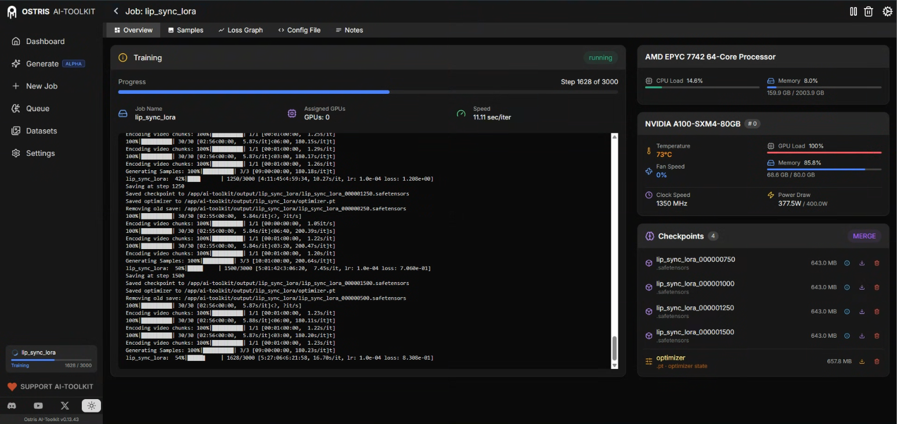
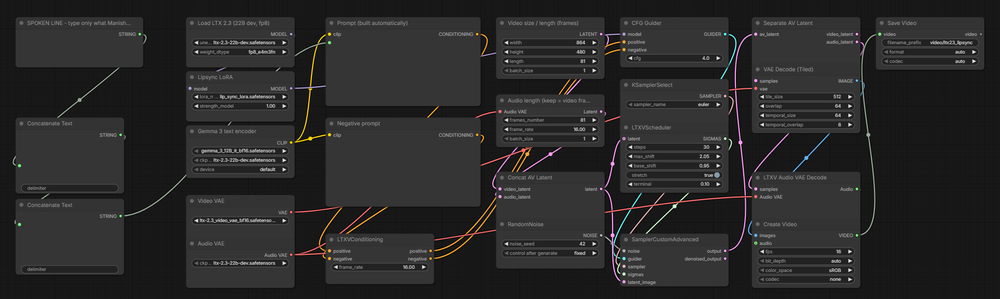
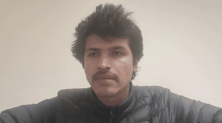
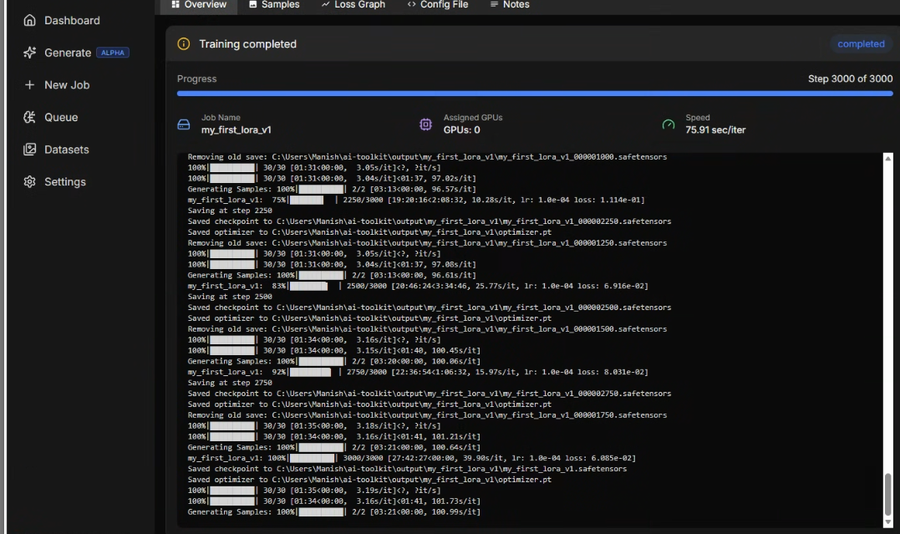
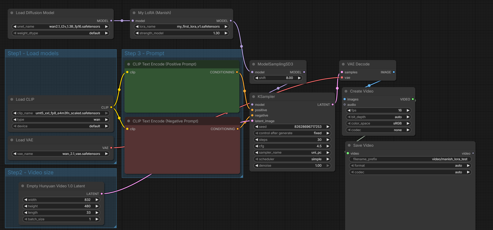
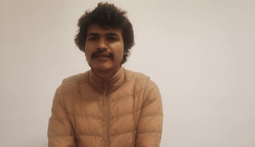
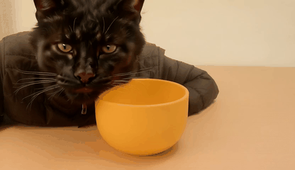
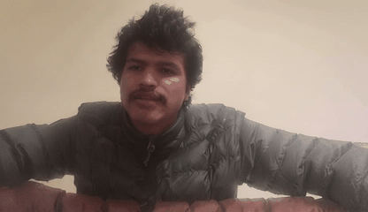
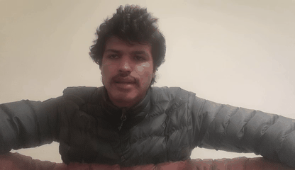

# Manish Lip-Sync LoRAs: LTX 2.3 (video + audio) and Wan 2.1 (video only)

Two character LoRAs that generate a talking video of Manish from a text prompt. You write what he should say:

```
Manish says "I am doing my assignment today."
```

| LoRA | Base model | Output | Folder |
|---|---|---|---|
| [1. LTX 2.3 lip-sync LoRA](#1-ltx-23-lip-sync-lora-video--audio) | LTX-Video 2.3 22B dev | Video **with his voice** | [`ltx23-audio-video-lora/`](ltx23-audio-video-lora) |
| [2. Wan 2.1 lip-sync LoRA](#2-wan-21-lip-sync-lora-video-only) | Wan 2.1 T2V 1.3B | Video only (no audio) | [`wan21-video-lora/`](wan21-video-lora) |

---

## 1. LTX 2.3 lip-sync LoRA (video + audio)

The model generates both the video and the speech audio in one pass.

### Repository contents

| Path | What it is |
|---|---|
| `ltx23-audio-video-lora/comfyui/ltx23_lipsync_lora.json` | ComfyUI workflow (text → video + audio) |
| `ltx23-audio-video-lora/training/lip_sync_lora.yaml` | ai-toolkit training config |
| `ltx23-audio-video-lora/training/samples.zip` | Sample videos ai-toolkit generated every 250 steps during training |
| `ltx23-audio-video-lora/dataset/character_lora_dataset.zip` | Training dataset: 19 talking clips + caption `.txt` files |
| `ltx23-audio-video-lora/images/` | Screenshots of the training run and the ComfyUI workflow |
| `ltx23-audio-video-lora/results/` | 6 videos generated with the ComfyUI workflow (`.mp4` with audio, `.gif` previews) |

### Training

Trained with [ostris/ai-toolkit](https://github.com/ostris/ai-toolkit) v0.13.43 on a single **NVIDIA A100-SXM4-80GB**.



| Setting | Value |
|---|---|
| Base model | LTX-2.3 22B dev (`arch: ltx2.3`) |
| Network | LoRA, rank 32 / alpha 32 |
| Steps | 3000 (batch size 1) |
| Learning rate | 1e-4, AdamW 8-bit |
| Frames / FPS | 81 frames at 16 fps |
| Sample resolution | 853 × 480 |
| Dataset | 19 clips, captioned as `Manish says "<spoken line>"` |
| Audio | trained jointly with video (`do_audio: true`) |
| `low_vram` | false |

#### Training sample prompts

The prompts used for the in-training samples (`training/samples.zip`, recovered by transcribing the sample audio):

1. `Manish says "I am doing my assignment today."`
2. `Manish says "I am tired right now."`
3. `Manish says "Training LoRA is hard."`

#### Dataset

`dataset/character_lora_dataset.zip` holds 19 short clips (`video_N.mp4`) of Manish speaking to the camera, each with a caption file, for example:

```
Manish says "Hello guys, I am Manish Katel"
Manish says "I made coffee for myself"
Manish says "I went to the walk and came back to my work again."
```

### ComfyUI workflow



Uses only **core ComfyUI nodes** (no custom nodes). Tested on ComfyUI 0.42.5 with an RTX 4090 (24 GB): about 2 minutes per clip.

**How to use:** open `comfyui/ltx23_lipsync_lora.json` in ComfyUI. In the **SPOKEN LINE** box, type only the words (no quotes). The workflow turns them into `Manish says "<your words>"` automatically.

| Node | Setting |
|---|---|
| Diffusion model | `ltx-2.3-22b-dev.safetensors`, loaded as fp8_e4m3fn |
| LoRA | `lip_sync_lora.safetensors`, strength 1.0 |
| Text encoder | Gemma 3 12B (`LTXAVTextEncoderLoader`) |
| Video / audio VAE | LTX 2.3 video VAE, LTX audio VAE + vocoder |
| Size | 864 × 480, 81 frames, 16 fps (LTX needs width divisible by 32) |
| Sampler | Euler, 30 steps, `LTXVScheduler`, CFG 4 |
| Output | MP4 with audio (`SaveVideo`) |

**Model files** go in ComfyUI's `models/` folder:

```
models/diffusion_models/ltx-2.3-22b-dev.safetensors
models/checkpoints/ltx-2.3-22b-dev.safetensors        (same file, used by the audio VAE / text encoder loaders)
models/loras/lip_sync_lora.safetensors
models/text_encoders/gemma_3_12B_it_bf16.safetensors
models/vae/ltx-2.3_video_vae_bf16.safetensors
```

The LoRA weights (643 MB) are not in this repo because of GitHub's 100 MB file limit.

### Results

Six clips generated with the workflow above (click a preview to open the MP4 with audio):

| # | Spoken line | Preview |
|---|---|---|
| 1 | "I got lots of classes today, so I will see you all in the evening." | [](ltx23-audio-video-lora/results/result_1.mp4) |
| 2 | "I am tired right now." | [](ltx23-audio-video-lora/results/result_2.mp4) |
| 3 | "Welcome to my LinkedIn guys." | [](ltx23-audio-video-lora/results/result_3.mp4) |
| 4 | "Hello guys, I am Manish Katel" | [](ltx23-audio-video-lora/results/result_4.mp4) |
| 5 | "Today I am going to show you my new project." | [](ltx23-audio-video-lora/results/result_5.mp4) |
| 6 | "Thank you so much for watching, see you next time." | [](ltx23-audio-video-lora/results/result_6.mp4) |

GIF previews are silent; the MP4 files contain the generated speech.

---

## 2. Wan 2.1 lip-sync LoRA (video only)

The model generates a silent video of Manish mouthing the line.

### Repository contents

| Path | What it is |
|---|---|
| `wan21-video-lora/comfyui/lip_sync_lora.json` | ComfyUI workflow (text → video) |
| `wan21-video-lora/training/my_first_lora_v1.yaml` | ai-toolkit training config |
| `wan21-video-lora/training/samples.zip` | Sample videos ai-toolkit generated every 250 steps during training |
| `wan21-video-lora/dataset/resized_character_dataset.zip` | Training dataset: 13 talking clips + caption `.txt` files |
| `wan21-video-lora/images/` | Screenshots of the training run and the ComfyUI workflow |
| `wan21-video-lora/results/` | 6 videos generated with the ComfyUI workflow (`.mp4`, `.gif` previews) |

### Training

Trained with [ostris/ai-toolkit](https://github.com/ostris/ai-toolkit).



| Setting | Value |
|---|---|
| Base model | Wan 2.1 T2V 1.3B (`Wan-AI/Wan2.1-T2V-1.3B-Diffusers`, `arch: wan21:1b`) |
| Network | LoRA, rank 16 / alpha 16 |
| Steps | 3000 (batch size 1) |
| Learning rate | 1e-4, AdamW 8-bit |
| FPS | 16 (`auto_frame_count: true`) |
| Dataset resolution | 512, 768, 1024 buckets |
| Sample resolution | 768 × 512, 41 frames |
| Dataset | 13 clips, captioned as `Manish says "<spoken line>"` |
| Caption dropout rate | 1.05 |
| Quantization | qfloat8 (model and text encoder) |
| `low_vram` | false |

#### Training sample prompts

1. `Manish says "Random forest is the best model."`
2. `Manish says "LoRA training is hard"`

#### Dataset

`dataset/resized_character_dataset.zip` holds 13 short clips (`video_N.mp4`, 854 × 480, 30 fps) of Manish speaking to the camera, each with a caption file, for example:

```
Manish says "I made coffee for myself"
Manish says "and I had some good coffee and bread."
Manish says "I went to the walk and came back to my work again."
```

### ComfyUI workflow



Uses only **core ComfyUI nodes** (no custom nodes).

**How to use:** open `comfyui/lip_sync_lora.json` in ComfyUI and write the prompt as `Manish says "<your words>"`.

| Node | Setting |
|---|---|
| Diffusion model | `wan2.1_t2v_1.3B_fp16.safetensors` |
| LoRA | `my_first_lora_v1.safetensors`, strength 1.3 |
| Text encoder | `umt5_xxl_fp8_e4m3fn_scaled.safetensors` (type `wan`) |
| VAE | `wan_2.1_vae.safetensors` |
| Size | 832 × 480, 33 frames, 16 fps |
| Sampler | `KSampler`, uni_pc / simple, 30 steps, CFG 4.5, `ModelSamplingSD3` shift 8 |
| Output | MP4 (`SaveVideo`) |

**Model files** go in ComfyUI's `models/` folder:

```
models/diffusion_models/wan2.1_t2v_1.3B_fp16.safetensors
models/loras/my_first_lora_v1.safetensors
models/text_encoders/umt5_xxl_fp8_e4m3fn_scaled.safetensors
models/vae/wan_2.1_vae.safetensors
```

The LoRA weights (42 MB) are not in this repo.

### Results

Six clips generated with the workflow above (click a preview to open the MP4):

| # | Prompt | LoRA strength / CFG | Preview |
|---|---|---|---|
| 1 | `Manish says "Welcome to my portfolio website."` | 1.0 / 6.0 | [](wan21-video-lora/results/result_1.mp4) |
| 2 | `Manish says "The cat watched the cup, and it was round"` | 1.0 / 6.0 | [](wan21-video-lora/results/result_2.mp4) |
| 3 | `Manish says "This is a beautiful world"` | 1.0 / 6.0 | [](wan21-video-lora/results/result_3.mp4) |
| 4 | `Manish says "I got a wonderful life."` | 1.3 / 6.0 | [](wan21-video-lora/results/result_4.mp4) |
| 5 | `Manish says "Video model takes lots of resources."` | 1.3 / 5.0 | [](wan21-video-lora/results/result_5.mp4) |
| 6 | `Manish says "I got lots of classes today"` | 1.3 / 4.5 | [](wan21-video-lora/results/result_6.mp4) |
